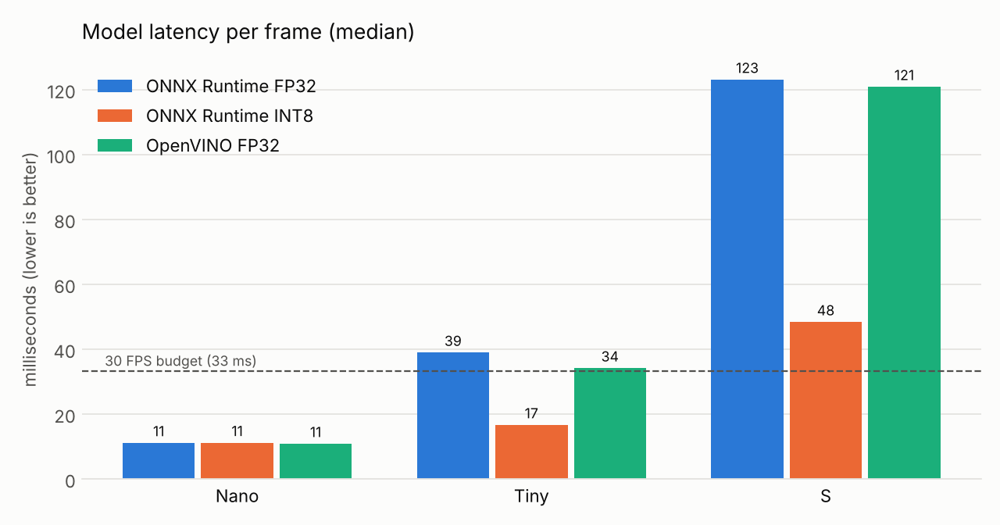
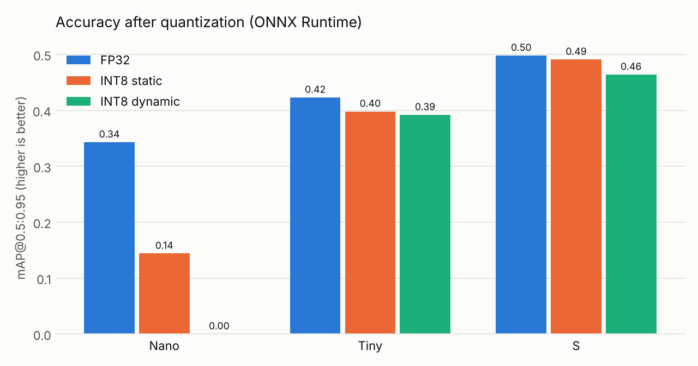
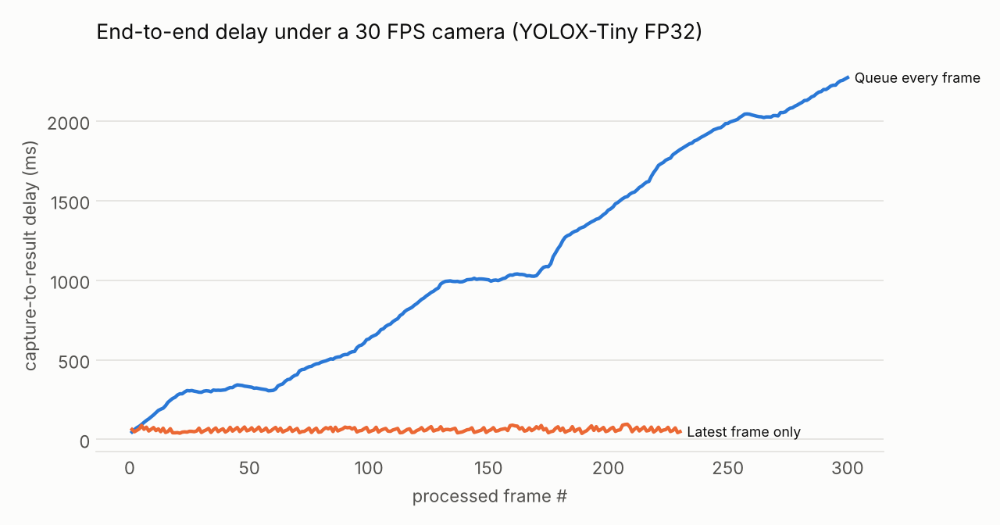

# edge-realtime-inference

**Real-time object detection on a plain CPU, measured.** A small, reproducible study of how far a
no-GPU machine can go with modern inference runtimes, and which levers actually matter:
model size, INT8 quantization, runtime choice, threads, graph optimization and pipeline design.

It ships three things:

1. **`edgeinfer/`** - a dependency-light detector (YOLOX on ONNX Runtime, optional OpenVINO) and a
   real-time capture/inference pipeline that keeps latency bounded by dropping stale frames.
2. **`benchmark.py`** - one command that measures latency, accuracy and real-time behaviour on
   *your* hardware and writes JSON plus charts.
3. **`run_realtime.py`** - a live demo on a webcam, a video file, or a synthetic camera (for
   machines with no webcam).

## Headline results

Measured on a 2-vCPU cloud VM (Intel Xeon 2.1 GHz, AVX-512 + VNNI + AMX), no GPU, 2 threads,
ONNX Runtime 1.29 and OpenVINO 2026.4. Full data: [`results/cloud-vm-2vcpu/`](results/cloud-vm-2vcpu/).

| YOLOX model | FP32 latency | INT8 static latency | Speed-up | mAP FP32 → INT8 |
| --- | --- | --- | --- | --- |
| Nano (0.9 M params) | 11.2 ms | 11.2 ms | 1.0x | 0.343 → 0.144 (broken) |
| Tiny (5.1 M) | 39.0 ms | 16.7 ms | 2.3x | 0.423 → 0.398 |
| S (9.0 M) | 123.1 ms | 48.4 ms | 2.5x | 0.498 → 0.491 |

* **Static INT8** brings Tiny from over the 33 ms (30 FPS) budget to half of it; S in INT8 beats Tiny in FP32 on accuracy at similar cost.
* **Dynamic INT8** is 4-6x *slower* than FP32 on these conv nets. Use it for transformers/RNNs only.
* **Runtime defaults matter**: OpenVINO's default precision ran FP32 models in bfloat16 on this AMX CPU (3.4x faster on S);
  ONNX Runtime's default thread count used one core (59 ms vs 38 ms pinned to two).
* **Frame policy matters most for latency**: with Tiny FP32 under a 30 FPS camera, queuing every frame let delay grow to
  2.3 s in 10 s; the `latest` policy held it under 100 ms. With Tiny INT8 the pipeline keeps up: 30 FPS, 19 ms median delay.





mAP is measured on 96 COCO128 images that YOLOX saw in training, so it is useful for FP32-vs-INT8
comparison only (see Caveats).

## Quick start

```bash
python -m venv .venv && source .venv/bin/activate      # Windows: see "Windows (PowerShell)" below
pip install -r requirements-dev.txt                     # requirements.txt alone if you skip OpenVINO/charts/tests
python scripts/download_assets.py                       # 3 YOLOX models + COCO128 sample data (~70 MB)
python scripts/quantize.py models/yolox_tiny.onnx       # builds the INT8 variants
python run_realtime.py --source 0 --model models/yolox_tiny.int8-static.onnx   # webcam, press q to quit
```

No webcam? `python run_realtime.py --source synthetic --headless --save out.mp4`.

### Windows (PowerShell)

Windows PowerShell 5.1 does not accept `&&`, and `make` is not installed, so run the steps one per line:

```powershell
python -m venv .venv
.venv\Scripts\Activate.ps1
pip install -r requirements-dev.txt
python scripts/download_assets.py
python scripts/quantize.py models/yolox_tiny.onnx
python -m pytest -q
python run_realtime.py --source 0 --model models/yolox_tiny.int8-static.onnx --threads $env:NUMBER_OF_PROCESSORS
```

* If `python` opens the Microsoft Store, Python is installed but not on `PATH`. Create the venv with the full
  path instead, e.g. `& "$env:LOCALAPPDATA\Programs\Python\Python312\python.exe" -m venv .venv`. Inside the
  activated venv, plain `python` and `pip` work.
* If `Activate.ps1` is blocked, run `Set-ExecutionPolicy -Scope CurrentUser RemoteSigned` once.
* Full study without `make`:

  ```powershell
  foreach ($m in "yolox_nano","yolox_tiny","yolox_s") { python scripts/quantize.py models/$m.onnx }
  python benchmark.py --out results/local
  python scripts/plot_results.py results/local/benchmark.json
  ```

### Demo options

| Command | What it does |
| --- | --- |
| `python run_realtime.py --source 0` | webcam 0 in a live window; press `q` to quit |
| `python run_realtime.py --source clip.mp4` | a video file, replayed at its own frame rate as if it were a camera |
| `python run_realtime.py --source synthetic --headless --save out.mp4` | a synthetic 30 FPS camera, no window, annotated video saved |
| `--model models/yolox_s.int8-static.onnx` | a more accurate, slower model (run `scripts/quantize.py` on it first) |
| `--policy queue` | queue every frame instead of keeping the latest, to watch the delay grow |
| `--threads N` | ONNX Runtime threads; the default (0) can leave cores idle, so pass your CPU count |
| `--score 0.2` | show lower-confidence detections (default 0.35) |
| `--json run.json` | write the run summary (FPS, drop rate, end-to-end delay percentiles) to a file |

The detector only knows the 80 COCO classes listed in `edgeinfer/coco.py`. Anything else is reported
as the closest of those classes (a wardrobe may show up as "refrigerator").

Full study on your machine (10-20 minutes):

```bash
make bench          # = quantize all models, run benchmark.py, draw the charts into results/<hostname>/
```

or with Docker (CPU only, headless):

```bash
docker build -t edge-rt . && docker run --rm -v "$PWD/results:/app/results" edge-rt
```

## How it works

```
 camera / video / synthetic        capture thread                      inference loop (main thread)
 ──────────────────────────►  paces frames at the source FPS  ──►  [ slot ]  ──►  letterbox ─► ONNX model ─► decode + NMS ─► draw / save
                               (does not wait for the model)      one frame         ~1 ms        the cost       ~1 ms
                                                                  newest wins
```

* **`edgeinfer/detector.py`** - letterbox pre-processing, ONNX Runtime or OpenVINO session, YOLOX grid
  decoding and class-aware NMS, all in NumPy. Each `detect()` returns per-stage timings.
* **`edgeinfer/realtime.py`** - the capture thread and two buffering policies:
  * `latest` (default): a one-slot mailbox. Frames that arrive while the model is busy are dropped,
    so the frame being analysed is never older than about one inference.
  * `queue`: an unbounded FIFO. Nothing is dropped, so every frame waits behind the backlog and
    delay grows without limit when the model is slower than the camera. Kept only to measure it.
* **`scripts/quantize.py`** - FP32 to INT8 with ONNX Runtime's quantizer: *dynamic* (no calibration)
  and *static* QDQ with per-channel weights, calibrated on 32 images. Upgrades the opset-11 YOLOX
  exports to opset 13 first, which per-channel QDQ requires.
* **`edgeinfer/evaluate.py`** - a small COCO-style mAP evaluator (101-point AP, IoU 0.50:0.95) for
  comparing FP32 and INT8 variants of the same model.

## Repository layout

```
edgeinfer/              library: detector, real-time pipeline, evaluator, class names
scripts/
  download_assets.py    models + COCO128, checksum-verified
  quantize.py           FP32 -> INT8 dynamic + INT8 static
  plot_results.py       benchmark.json -> PNG charts
run_realtime.py         live demo
benchmark.py            the study
tests/                  unit tests (no downloads) + model tests (skipped until assets exist)
results/                one folder per machine: benchmark.json, log, charts
```

## Benchmark options

| Command | What it does |
| --- | --- |
| `python benchmark.py` | everything, threads pinned to all logical CPUs |
| `python benchmark.py --only variants` | just the model x precision x runtime table |
| `python benchmark.py --threads 4` | pin a different thread count |
| `python benchmark.py --no-openvino` | ONNX Runtime only |
| `python benchmark.py --quick` | fewer runs and images, for a smoke test |

## Caveats

* **Your numbers will differ.** Results depend heavily on the CPU's instruction set: INT8 needs
  VNNI (Intel/AMD) or dot-product (Arm) instructions to pay off, and OpenVINO silently switches
  FP32 models to bfloat16 on CPUs with AMX. Run the benchmark on the hardware you will deploy on.
* **mAP here is for comparison only.** COCO128 is drawn from COCO *train* 2017, which YOLOX was
  trained on, so absolute scores are inflated. The FP32-vs-INT8 differences are what matter.
* **Not production code.** No tracking, no batching, no GPU paths. It is a measurement harness
  with a working demo on top.

## Licences

* This repository: Apache-2.0 (see `LICENSE`).
* `assets/dog.jpg`, `assets/demo.png`: sample images from the YOLOX repository (Apache-2.0).
* YOLOX models: Apache-2.0, [Megvii-BaseDetection/YOLOX](https://github.com/Megvii-BaseDetection/YOLOX),
  downloaded at run time.
* COCO128: the first 128 images of COCO train 2017, packaged by Ultralytics; COCO annotations are
  CC BY 4.0 and the images keep their original Flickr licences. Downloaded at run time, never committed.
